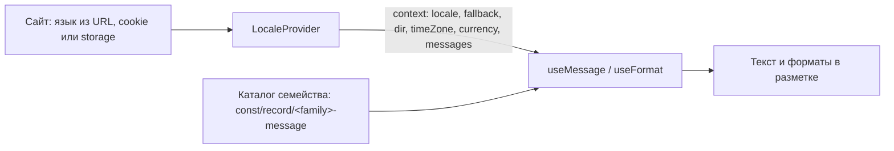

# localization

Язык компонентов библиотеки: перевод собственного интерфейса компонентов, форматы дат,
чисел и денег, направление письма. Контент (заголовки и тексты из props) переводит сайт;
для него есть тип `LocalizedText` и функция `pickLocalized`.

## Как это работает



- **LocaleProvider** (`component/atom/locale-provider`) передаёт язык всем компонентам внутри, как
  ThemeProvider передаёт тему. Он ставит `lang` и `dir` на свою обёртку (`display: contents`);
  `document` дублирует их на `<html>`. Язык выбирает сайт, библиотека не читает storage, поэтому
  SSR рендерит сразу нужный язык.
- **Без провайдера** компоненты говорят по-английски (`LOCALIZATION_LOCALE_FALLBACK = 'en'`).
- **Поиск строки** (`resolveMessage`): prop компонента → `messages` провайдера по имени
  `<namespace>.<key>` → каталог на текущем языке → на его базовом языке (`ru-RU` → `ru`) →
  `fallback` → `en` → сам ключ.
- **Множественное число**: значение-объект по категориям CLDR (`zero`, `one`, `two`, `few`,
  `many`, `other`), форма выбирается `Intl.PluralRules` по `values.count`. Русскому нужны `one`,
  `few`, `many`; арабскому — все шесть; китайскому — только `other`.
- **Подстановки**: `{name}`; числа форматируются для языка (`1 200`, `1,200`).
- **Направление**: `resolveTextDirection` — `rtl` для арабского, иврита, фарси, урду и др.

## Как сделать компонент локализуемым

1. Каталог семейства: `<домен>/const/record/<family>-message/index.ts`, одна константа
   `<DOMAIN>_<FAMILY>_MESSAGE` с языками `en` (полный) и `ru` (полный), остальные — по мере
   перевода:

   ```ts
   export const PAGER_PAGER_MESSAGE = {
   	en: {
   		next: 'Next',
   		page: 'Page {page} of {total}',
   		results: { one: '{count} result', other: '{count} results' }
   	},
   	ru: {
   		next: 'Далее',
   		page: 'Страница {page} из {total}',
   		results: {
   			one: '{count} результат',
   			few: '{count} результата',
   			many: '{count} результатов',
   			other: '{count} результата'
   		}
   	}
   } as const;
   ```

2. В компоненте: `const t = useMessage('<family>', <CATALOG>)` при инициализации, в разметке
   `t('next')`, `t('page', { page, total })`. Все `aria-label`, `placeholder`, `title`, подписи,
   пустые состояния и статусы — только через `t`.
3. Текстовый prop (`nextLabel`, `closeLabel`) остаётся необязательным и побеждает каталог:
   `{nextLabel ?? t('next')}`. Значения по умолчанию в `$props()` для текстов не пишутся.
4. Даты, числа, деньги — `const format = useFormat()`: `format.date(value, options)`,
   `format.number`, `format.money(minor, minorUnit, currency)`, `format.relative`. Никаких
   `'ru-RU'`/`'en-US'` и `toLocaleString()` без локали.
5. Раскладка — логические свойства (`margin-inline-start`, `inset-inline-end`, `text-align: start`),
   чтобы компонент работал справа налево.
6. Проверка: тест `test/unit/message-catalog` находит все каталоги рабочей папки и требует
   полноты `en` и `ru` (`LOCALIZATION_LOCALE_REQUIRED`). В песочнице язык меняется настройкой
   «Language» на панели.

## Переопределения сайта

```svelte
<LocaleProvider
	locale={data.lang}
	timeZone="Europe/Moscow"
	currency="RUB"
	messages={{ 'pager.next': 'Дальше' }}
	document
>
	{@render children()}
</LocaleProvider>
```

## Состав

| Кластер     | Сущности                                                                                                                                                                          |
| ----------- | --------------------------------------------------------------------------------------------------------------------------------------------------------------------------------- |
| `const`     | `LOCALIZATION_LOCALE_FALLBACK`, `LOCALIZATION_LOCALE_REQUIRED`, `LOCALIZATION_LOCALE_RTL`, `LOCALIZATION_PLURAL_CATEGORY`, `LOCALIZATION_LOCALE_CONTEXT`, каталог `LocalePreview` |
| `type`      | `LocaleCode`, `PluralCategory`, `PluralMessage`, `MessageValue`, `MessageCatalog`, `LocalizedText`, `TextDirection`                                                               |
| `interface` | `ContractLocaleContext`, `RecipeLocaleProvider`, `RecipeLocalePreview`                                                                                                            |
| `class`     | `ManagerLocaleContext`                                                                                                                                                            |
| `function`  | `resolveMessage`, `pickLocalized`, `resolveTextDirection`, `checkMessageCatalog`, `useLocale`, `useMessage`, `useFormat`, форматтеры `format*`                                    |
| `component` | `LocaleProvider`, `LocalePreview`, `LanguageSelector`, `LocaleSwitcher`, `TranslationEditor`, `CountryFlag`                                                                       |

## Компоненты домена

Эталон миграции: LanguageSelector, LocaleSwitcher, TranslationEditor и CountryFlag. Все тексты в
каталогах `const/record/<family>-message` (en, ru полные; ar, he для RTL-пресетов), стили в
`@layer localization` под `:where`, логические свойства, html-обёртки, id через `$props.id()`.
Тест `test/unit/style-layer` проверяет стили, `test/render/localized-components` — смену языка
в LocaleProvider.

- **LocaleSwitcher**: превью дат форматируется в _выбранной_ локали и поясе (явная локаль,
  `function/transform/format-date|format-time|format-date-time`), а подписи — на языке интерфейса.
  Невалидный код или пояс откатываются на значения провайдера.
- **TranslationEditor**: правки держатся локальным слоем поверх `texts` (prop не мутируется) и
  уходят в `onTranslationChange`. `onImport(file: File)` отдаёт выбранный `.json`: формат файла
  знает сайт. Кнопки импорта, экспорта и сохранения видны только с обработчиками.
- **CountryFlag**: доступное имя — страна на языке интерфейса (`Intl.DisplayNames`).
- `function/format-date-time` устарел (`@deprecated`): остаётся до следующей генерации barrel.

## Отложено

Шрифты для письменностей (`:lang(zh)`, `:lang(hi)`, `:lang(ar)`) в теме и зеркалирование
направленных иконок (`chevron-*`, `arrow-*`) в `dir="rtl"`.
